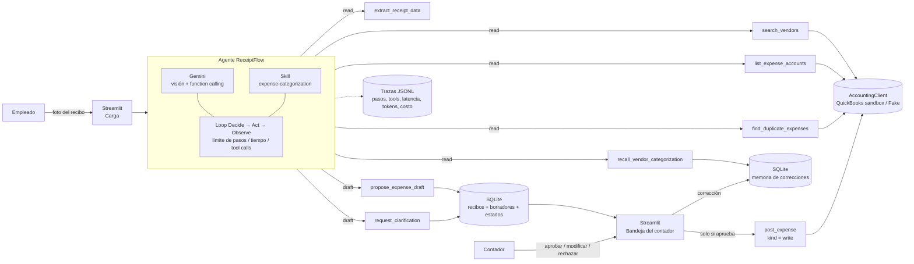
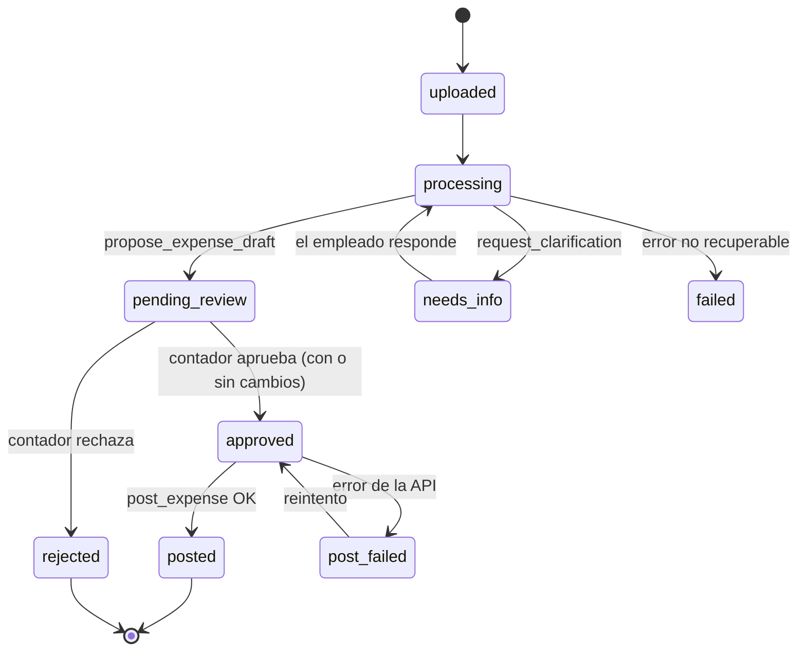

# Entrega Parcial 1 — ReceiptFlow

**Agente de carga de gastos desde recibos hacia QuickBooks Online, con aprobación del contador**

| | |
|---|---|
| **Proyecto** | ReceiptFlow |
| **Integrantes** | Nicolás Ricci |
| **Curso** | Certificación Profesional en AI Agent Developer — ITBA |
| **Entrega** | Parcial 1 (post Clase 10): idea, caso de uso, alcance y arquitectura preliminar |

---

## 1. Problema

En una pyme, cada gasto que paga un empleado (combustible, almuerzo con un cliente, insumos, un taxi) termina como un recibo en papel o una foto en el celular. Para que ese gasto exista en la contabilidad alguien tiene que:

1. Juntar los recibos (por mail, WhatsApp o en mano).
2. Leer cada uno y transcribir proveedor, fecha, monto e impuestos.
3. Buscar si el proveedor ya existe en el sistema contable o darlo de alta.
4. Elegir la cuenta contable correcta del plan de cuentas.
5. Verificar que el gasto no se haya cargado antes.
6. Registrarlo en el sistema contable (en este caso, QuickBooks Online).

Es trabajo manual, repetitivo y propenso a errores: tipeo de montos, cuentas mal elegidas, duplicados, proveedores repetidos con nombres distintos ("YPF Río IV" / "YPF S.A."). Al mismo tiempo **no se puede automatizar a ciegas**: un asiento mal registrado tiene consecuencias contables e impositivas, así que el contador necesita tener la última palabra.

## 2. Usuarios

| Rol | Qué hace en el sistema | Qué gana |
|---|---|---|
| **Empleado** | Sube la foto del recibo y, si el agente lo pide, aclara datos faltantes. | No completa formularios ni conoce el plan de cuentas. |
| **Contador / responsable administrativo** | Revisa la bandeja de borradores, los aprueba, corrige o rechaza. Solo lo aprobado se registra. | Pasa de *transcribir* a *revisar*: cada borrador llega con proveedor matcheado, cuenta sugerida, chequeo de duplicados y la justificación del agente. |

## 3. Caso de uso

**Recorrido principal (happy path):**

1. El empleado sube la foto de un ticket de combustible de YPF.
2. El agente extrae los datos del recibo (proveedor, CUIT, fecha, total, IVA) en un esquema validado.
3. El agente busca el proveedor en QuickBooks y encuentra una coincidencia por CUIT.
4. Consulta la memoria: este proveedor ya fue imputado antes a *"Combustibles y movilidad"*.
5. Verifica que no exista un gasto con el mismo proveedor, fecha y monto.
6. Propone un **borrador** con la cuenta sugerida, el nivel de confianza y la justificación.
7. **El agente se detiene.** El borrador queda *pendiente de revisión*.
8. El contador lo revisa en la bandeja y lo **aprueba**, lo **modifica** (por ejemplo, cambia la cuenta) o lo **rechaza** con un motivo.
9. Al aprobarlo, el sistema registra el gasto en QuickBooks y adjunta la imagen del recibo.
10. Si el contador corrigió la cuenta, la corrección queda en memoria para los próximos recibos de ese proveedor.

**Caminos alternativos (donde el agente decide):**

| Situación detectada | Decisión del agente |
|---|---|
| El proveedor no existe en QuickBooks | Propone **alta de proveedor** dentro del borrador (se crea solo si el contador aprueba). |
| Hay varios proveedores parecidos | Elige el más probable y deja el match marcado como **ambiguo** para el contador, o pide el CUIT al empleado. |
| Existe un gasto muy similar ya registrado | Marca el borrador como **posible duplicado** con un link al gasto existente. |
| La imagen es ilegible o falta el total | **No inventa datos**: devuelve el recibo al empleado con una pregunta concreta (estado *necesita información*). |
| No hay historial para el proveedor | Usa las reglas de la skill para sugerir cuenta y baja el nivel de confianza. |

## 4. Alcance

**Dentro del alcance (MVP del TFI):**

- Una empresa en el **sandbox de QuickBooks Online** (cuenta de developer gratuita de Intuit).
- Recibos como imagen (JPG/PNG) de comercios argentinos típicos: combustible, gastronomía, supermercado, transporte, librería/insumos.
- Registro del gasto como **Purchase** (gasto pagado) en QuickBooks, con proveedor, cuenta, monto, fecha e imagen adjunta.
- Interfaz web con dos vistas: carga (empleado) y bandeja de revisión (contador).
- Memoria de correcciones del contador por proveedor.
- Cliente contable **fake** en memoria para tests, evaluación y ejecución sin credenciales.

**Fuera del alcance:**

- Recibos en moneda extranjera y manejo multi-moneda: todos los gastos se registran en pesos argentinos (ARS).
- Facturas de proveedores a pagar (*bills*), pagos, conciliación bancaria.
- Recibos manuscritos o PDFs de varias páginas.
- Multi-empresa, autenticación real de usuarios y permisos por rol productivos.
- Ingesta por email o WhatsApp.
- Uso productivo: es un proyecto educativo, con datos sintéticos o propios y cuentas personales.

## 5. Solución propuesta

Un **agente único** que, para cada recibo, ejecuta el ciclo *Decide → Act → Observe* visto en clase (`run_basic_agent`) usando un conjunto de tools de lectura y una tool de borrador. El agente **nunca escribe en QuickBooks**: su objetivo termina al proponer un borrador o al pedir una aclaración. La escritura real es una acción separada que se dispara únicamente con la aprobación humana.

Esta separación usa la clasificación de tools del curso (`ToolKind`):

- Tools `read` / `compute`: disponibles para el agente.
- Tool `draft`: el agente la usa para cerrar su trabajo.
- Tool `write`: **no está habilitada para el agente**. La ejecuta la aplicación con un `ExecutionContext(allow_external_writes=True)` solo después del "aprobar" del contador.

## 6. Arquitectura preliminar

**Enfoque elegido: A — Agente único robusto.**

**Componentes y cómo cubren los requisitos del TFI:**

| # | Requisito | Implementación prevista | Base en el curso |
|---|---|---|---|
| 1 | Capacidad agéntica | Loop con selección dinámica de tools; caminos distintos según proveedor, duplicados y calidad del recibo. Validación con Pydantic de entradas y salidas de cada tool, reintentos y errores tipados. | C9 — `agent_loop.py`, `tools.py` (`ToolRegistry`, `ToolPolicy`) |
| 2 | Skill reutilizable | `expense-categorization`: procedimiento de imputación, reglas gasto → cuenta, manejo de IVA y ejemplos. | C10 — `skills.py` (`SkillLoader`) |
| 3 | Estado y memoria | Estado de cada recibo en SQLite (máquina de estados) + memoria persistente de correcciones por proveedor entre sesiones. | C10–C11 — `memory.py` (`MemoryStore`) |
| 4 | Human-in-the-Loop | El registro en QuickBooks queda pausado hasta que el contador aprueba, modifica o rechaza el borrador. | C11 |
| 5 | Integración externa | API de QuickBooks Online (OAuth 2.0, sandbox): Vendor, Account, Purchase, Attachable. | C9 / C13 |
| 6 | Interfaz accesible | App Streamlit con dos páginas (carga y bandeja). | C14 |
| 7 | Ejecución reproducible | Docker Compose, `.env.example`, modo *fake* sin credenciales por defecto (`USE_REAL_GEMINI=0`, `USE_REAL_QBO=0`), igual que en el proyecto del curso. | C3 / C14 |
| 8 | Evidencia de calidad | Tests de tools y del recorrido principal con `FakeProvider` + cliente contable fake; dataset de recibos con ground truth; métricas y trazas. | C15 |

**Máquina de estados del recibo:**

**Por qué agente único y no multiagente:** el problema tiene un solo dominio (gasto → asiento) y un solo flujo. Separar extracción, matching y categorización en agentes distintos agregaría delegación y consolidación sin aportar capacidades nuevas, algo que la consigna explícitamente no valora. La extracción por visión se encapsula como una tool más.

**Por qué no RAG:** el conocimiento que necesita el agente (proveedores y plan de cuentas) es **estructurado y cambia**; se consulta en vivo por API, que es más exacto que indexarlo. Las reglas de imputación son pocas y entran completas en la skill. El historial de correcciones se recupera por clave (proveedor), no por similitud semántica.

## 7. Tools previstas

| Tool | Kind | Qué hace | Decisión que habilita |
|---|---|---|---|
| `extract_receipt_data` | `compute` | Gemini visión → `ReceiptData` validado (proveedor, CUIT, fecha, total, IVA, ítems, confianza por campo). | ¿Los datos alcanzan o hay que pedir aclaración? |
| `search_vendors` | `read` | Busca proveedores en QuickBooks por CUIT o nombre aproximado. | Match exacto, ambiguo o proveedor nuevo. |
| `list_expense_accounts` | `read` | Devuelve el plan de cuentas de gastos (con caché). | Qué cuenta corresponde. |
| `find_duplicate_expenses` | `read` | Busca gastos con mismo proveedor, monto y fecha cercana (QuickBooks + base local). | Marcar o no como posible duplicado. |
| `recall_vendor_categorization` | `read` | Consulta la memoria: cómo imputó el contador a este proveedor antes. | Priorizar el historial sobre la regla genérica. |
| `propose_expense_draft` | `draft` | Guarda el borrador (con justificación y confianza) y pasa el recibo a *pendiente de revisión*. **Termina el run.** | — |
| `request_clarification` | `draft` | Devuelve el recibo al empleado con una pregunta concreta. **Termina el run.** | — |
| `post_expense` | `write` | Crea el proveedor (si hace falta) y el Purchase en QuickBooks, y adjunta la imagen. **No disponible para el agente**: la invoca la aplicación tras la aprobación. | — |

Todas las tools reciben argumentos validados con Pydantic (`args_model`), devuelven `ToolResult` y tienen timeout. Las de lectura externa tienen reintentos con backoff ante errores transitorios (`RetryableToolError`). Las credenciales y los tokens se enmascaran en las trazas (`sanitize_for_trace`).

## 8. Skill propuesta: `expense-categorization`

Skill en el formato del curso (`SKILL.md` con frontmatter + recursos), activada cuando el input es un recibo, ticket o comprobante de gasto.

**Contenido:**

- **Workflow:** extraer → validar campos críticos → identificar proveedor → consultar historial → elegir cuenta → chequear duplicados → proponer o pedir aclaración.
- **Reglas:** nunca inventar montos ni fechas, un borrador no es un registro, el IVA discriminado (factura A) va por separado, el historial del contador tiene prioridad sobre la regla genérica.
- **Recurso `references/categorization-rules.md`:** tabla de rubros → cuenta contable con palabras clave y ejemplos (combustible, gastronomía, viáticos, insumos de oficina, software, etc.).
- **Recurso `references/receipt-checklist.md`:** campos obligatorios por tipo de comprobante argentino (ticket, factura A/B/C) y umbrales de confianza.

El borrador inicial ya está en `skills/expense-categorization/`.

## 9. Plan de evaluación (preliminar)

- **Dataset:** 15–20 recibos (sintéticos generados + propios anonimizados) con ground truth en JSON: campos esperados, proveedor esperado, cuenta esperada y decisión esperada (draft / duplicado / aclaración / proveedor nuevo).
- **Métricas:** precisión por campo extraído, acierto de cuenta, acierto de matching de proveedor, acierto de decisión, tool selection, cantidad de pasos, latencia, tokens y costo estimado por recibo.
- **Tests:** unitarios de cada tool con el cliente fake; test end-to-end del recorrido principal con `FakeProvider`; test de que `post_expense` no se ejecuta sin aprobación.
- **Trazabilidad:** traza JSONL por run (`run_id`, decisiones, tools, observaciones, stop reason), siguiendo el formato del curso.

## 10. Riesgos y mitigaciones

| Riesgo | Mitigación |
|---|---|
| OAuth de QuickBooks complica la reproducibilidad para el corrector. | Modo fake por defecto; script guiado para obtener el refresh token del sandbox; video de respaldo. |
| La API externa falla durante la demo. | Reintentos + estado `post_failed` reintentable + cliente fake. |
| El agente se vuelve un pipeline fijo. | Casos de evaluación diseñados para cada camino alternativo; la métrica de tool selection lo hace visible. |
| Errores de extracción en tickets térmicos de baja calidad. | Confianza por campo + `request_clarification` por debajo del umbral. |
